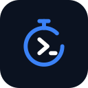

<p align="center"></p>

# CodeSprint for Zed

**Focus. Code. Improve.**

A Pomodoro focus timer, daily coding goal, streak tracking and productivity statistics for the [Zed](https://zed.dev) editor, driven from the Agent panel.

Everything is stored locally. No account, no telemetry, and your source code is never read or transmitted.

## How it differs from the VS Code version

Zed extensions run as sandboxed WebAssembly and can add languages, themes, slash commands and MCP servers, but not sidebar panels, webviews or status-bar items. CodeSprint for Zed therefore keeps the same engine and replaces the dashboard with conversation:

| VS Code | Zed |
| --- | --- |
| Sidebar dashboard | Ask the Agent: "show my stats" |
| Status bar countdown | Ask "how much time is left?" |
| Start/pause buttons | "Start a focus session", "pause" |
| Native notification | Desktop notification when a session ends |
| Settings UI | `settings.json` |

The timer logic, accuracy guarantees, goal and streak rules are shared code, covered by the same unit tests.

## Features

- Focus (25), short break (5) and long break (15) sessions, all configurable.
- **Timestamp-based accuracy**: survives restarts and sleep. A session that finishes while Zed is closed is credited the next time it starts.
- Daily goal with progress bar; current and longest streak; weekly overview; lifetime sessions.
- Only completed focus sessions count. Reset or abandoned sessions never do.
- Desktop notification at the end of each session (macOS, Windows, Linux with `notify-send`).
- Safe by design: destructive actions (reset, switch type mid-session, clear data) are flagged to the model, and clearing data requires explicit confirmation.

## Install

Search for **CodeSprint** in `zed: extensions`. Node.js is managed by Zed, so there is nothing else to install.

Then open the Agent panel, enable the CodeSprint tools and ask, for example:

- "Start a focus session"
- "Pause the timer" / "Resume"
- "Switch to a short break"
- "What's my streak and weekly total?"

A model with tool-calling support is required.

## Settings

Add to Zed's `settings.json`; all keys are optional:

```json
{
  "context_servers": {
    "codesprint": {
      "settings": {
        "focusMinutes": 50,
        "shortBreakMinutes": 10,
        "dailyGoalMinutes": 180,
        "notifications": true
      }
    }
  }
}
```

| Key | Default | Range |
| --- | --- | --- |
| `focusMinutes` | 25 | 1-180 |
| `shortBreakMinutes` | 5 | 1-60 |
| `longBreakMinutes` | 15 | 1-120 |
| `sessionsBeforeLongBreak` | 4 | 2-10 |
| `dailyGoalMinutes` | 120 | 5-1440 |
| `notifications` | true | boolean |
| `autoBreakSuggestions` | true | boolean |

## Data and privacy

Data lives in a single `data.json` under your user data directory (`~/.local/share/codesprint`, `~/Library/Application Support/CodeSprint` or `%APPDATA%\CodeSprint`). The server makes no network requests.

## Repository layout

```
extension.toml, Cargo.toml, src/lib.rs   Zed extension (Rust -> WebAssembly)
configuration/                            Settings schema and in-app install text
server/                                   MCP server (TypeScript, zero dependencies)
```

See [PUBLISHING.md](PUBLISHING.md) for build and release steps.

## License

MIT. See [LICENSE](LICENSE).
